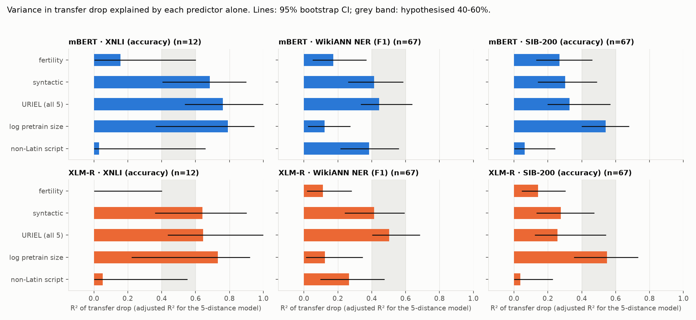
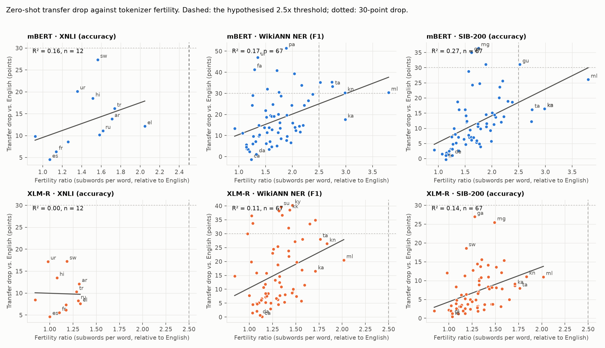
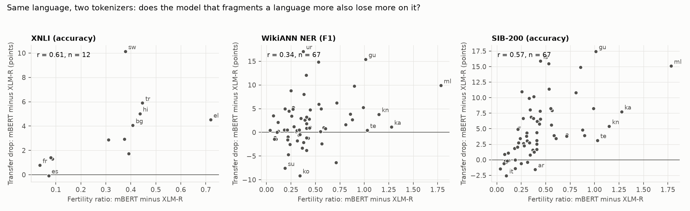
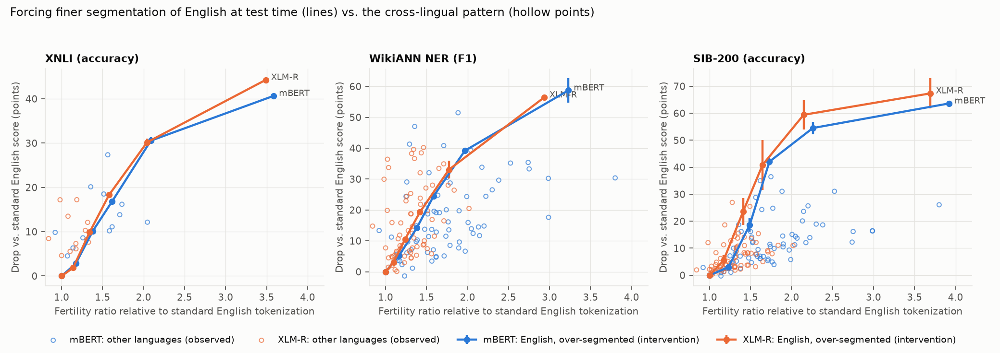

# Tokenizer Fertility and Cross-Lingual Transfer Degradation

## 1. Executive Summary

**Question.** Does a target language's tokenizer fertility ratio (subwords per word,
relative to English) explain 40-60% of the variance in zero-shot transfer degradation,
beat typological distance as a predictor, produce catastrophic failure above 2.5x, and do
so independently of pretraining data size?

**Answer: the hypothesis is not supported as stated.** Across mBERT and XLM-R on three
tasks (XNLI, WikiANN NER, SIB-200; up to 71 target languages), fertility explains
**0-27%** of the between-language variance in transfer drop, below the hypothesised
40-60% in all six model-task cells. Syntactic distance from English explains more than
fertility in every cell (28-68%), and pretraining corpus size explains clearly more in four
of six (the two NER cells are a tie). Pooled over cells, fertility R² = 0.16 [0.07, 0.28] against 0.37 for syntactic
distance and 0.32 for log corpus size. Once size and syntactic distance are controlled,
fertility adds at most 5 points of R², and is distinguishable from zero in one cell only.

**What does hold.** Fertility is positively associated with drop in five of six cells.
Within a language, the model whose tokenizer fragments it more loses more on it
(r = 0.34 to 0.61). Artificially over-segmenting English at test time is very damaging
(10-24 points lost at 1.4x fertility, 30-59 at about 2x). So fragmentation can hurt; it is
just not what separates languages that transfer well from those that do not. One
exploratory result deserves follow-up: an alternative fertility definition (tokens per
parallel sentence) reaches R² = 0.44-0.51 on SIB-200 and survives controls there, but not
on NER or XNLI.

**Practical implication.** Fertility alone is a weak screening signal for transfer risk.
Syntactic distance and pretraining volume are more informative, and for NER, script.
The 2.5x threshold is not usable as a rule: no whitespace-segmented language reaches it
under XLM-R's tokenizer, and under mBERT's the six that do fail on NER but not on topic
classification.

## 2. Research Question & Motivation

Multilingual encoders are fine-tuned on English and applied to other languages. If the
loss is driven by how finely the shared vocabulary fragments a language, it is fixable by
tokenizer design; typological distance is not fixable. The hypothesis makes four claims:

- **H1** fertility ratio explains 40-60% of the variance in transfer degradation;
- **H2** it outperforms typological distance as a predictor;
- **H3** above 2.5x English there is catastrophic failure (>30% accuracy drop);
- **H4** the effect is independent of training data size.

**Prior work** (from my knowledge of the literature; the pre-gathered review was absent,
see Section 6). Ács (2019) introduced fertility for mBERT. Rust et al. (2021) showed mBERT
over-segments some languages and that this hurts monolingual downstream quality. Pires et
al. (2019) and Lauscher et al. (2020) relate zero-shot transfer to typological similarity
and pretraining corpus size; Wu & Dredze (2020) show mBERT serves low-resource languages
poorly. A head-to-head test of fertility against typology and size on the same transfer
drops, across tasks and tokenizers, with fertility separated from language identity, was
the gap addressed here.

## 3. Experimental Setup

The analysis plan was written in `planning.md` before any model was trained; deviations
are logged at the end of that file and summarised in 3.6.

### 3.1 Models
| Key | Hugging Face ID | Tokenizer | Pretraining data |
|---|---|---|---|
| mBERT | `bert-base-multilingual-cased` | WordPiece, 119k | Wikipedia, 104 languages |
| XLM-R | `xlm-roberta-base` | SentencePiece unigram, 250k | CC-100, 100 languages |

No LLM API was used: no `OPENROUTER_KEY` is set in the environment, and the hypothesis
concerns English-only fine-tuning of subword encoders, which needs local models.

### 3.2 Tasks (train on English only, test zero-shot)
| Task | Dataset | English train | Test per language | Targets | Metric |
|---|---|---|---|---|---|
| NLI | `facebook/xnli` | 100k subset of MNLI | 5,010 | 14 | accuracy |
| NER | `unimelb-nlp/wikiann` | 20,000 | 100 / 1,000 / 10,000 | 71 | span F1 (seqeval) |
| Topic classification | `Davlan/sib200` | 701 | 204 | 71 | accuracy |

**Languages.** All 72 languages (English + 71) that are in mBERT's pretraining list, in
XLM-R's, in Flores-200 and in WikiANN (`src/langs.py`). Restricting to languages both
models saw removes the unseen-language confound.

**Training.** Standard recipes, AdamW, linear schedule with 10% warmup, fp16, model
selection on English dev only. XNLI: 2 epochs, batch 32, lr 2e-5, max length 128, 3 seeds.
NER: 5 epochs, batch 32, lr 3e-5, max length 256, first-subword labelling, 3 seeds.
SIB-200: 20 epochs, batch 16, lr 2e-5, best English-dev epoch, 5 seeds. 22 runs in total.

### 3.3 Variables
- **Transfer drop** = English test score minus target test score, in points, averaged
  over seeds. (Relative drop is a constant multiple within a cell, so R² is identical.)
- **Fertility ratio (primary)**: subword tokens per whitespace word on the language's
  1,004 Flores-200 sentences, divided by the same for English (English: 1.32 for mBERT,
  1.40 for XLM-R). Chinese, Japanese, Thai and Burmese are not whitespace-segmented and
  are excluded from the primary analysis, leaving 67 targets (12 for XNLI).
- **Parallel token ratio (secondary)**: tokens on the Flores sentences divided by tokens
  on their English translations. Defined for all 71 targets.
- **Typological distance from English**: URIEL (lang2vec) syntactic distance as the
  primary baseline, plus phonological, inventory, genetic, geographic, and all five jointly.
- **Pretraining size**: log10 bytes of the language's Wikipedia dump (mBERT) or CC-100
  file (XLM-R).
- **Script**: non-Latin indicator.

### 3.4 Statistics
Language is the unit of analysis within each of the 6 model x task cells. R² from OLS
with 95% percentile bootstrap CIs over languages (10,000 resamples, seed 42); bootstrap CI
for R² differences; partial correlations with OLS t-tests; Holm correction across the six
cells; pooled model with drop z-scored within cell and bootstrap clustered by language.

### 3.5 Two designs that hold language fixed
- **Within-language contrast**: for each language, (mBERT fertility - XLM-R fertility)
  against (mBERT drop - XLM-R drop). Typology and test data cannot vary.
- **Intervention**: English test inputs are re-segmented so that no subword exceeds a
  cap of 6, 4, 3, 2 or 1 characters (`src/intervention.py`). The text, model and labels
  are unchanged; only granularity changes. With no cap the manual pipeline reproduces the
  standard tokenization exactly (checked on 300 examples per task and model, and asserted
  against the standard English score for every checkpoint).

### 3.6 Deviations from the plan
1. XNLI was trained on a fixed 100k subset of MNLI, not all 393k, because the GPUs were
   shared with other jobs and ran at 2-4 steps/s. English accuracy is therefore about 3
   points below published full-data numbers.
2. mBERT pretraining size uses Wikipedia dump bytes (Nov 2023) instead of article counts;
   the Wikimedia API rate-limited the machine. Neither is the 2018 dump mBERT was trained
   on.
3. URIEL distances were computed here as cosine distances on lang2vec feature vectors
   (Euclidean for geographic), because the installed package lacks precomputed distances.
4. Ten WikiANN targets have only 100 test sentences; kept, with a robustness row.
5. The script control in H4 was added after seeing the fertility table but before any
   regression was run.

### 3.7 Environment and cost
Python 3.11.14, torch 2.14.1+cu130, transformers 5.19.0, tokenizers 0.23.3, numpy 2.4.6,
pandas 3.0.6, scipy 1.17.1, statsmodels 0.15.0 (`requirements.txt`, `pyproject.toml`).
Hardware: 4x NVIDIA RTX A6000 (48 GB), shared with unrelated jobs throughout, so memory
and throughput varied. Wall time per run: SIB-200 2-4 min, NER 17-56 min, XNLI 29-45 min.
Training batch sizes 16-32, evaluation batch 128, mixed precision. No API cost.

## 4. Results

### 4.1 Transfer performance
| Task | Model | Seeds | English | Mean target | Mean drop | SD of drop | Largest drop |
|---|---|---|---|---|---|---|---|
| XNLI | mBERT | 3 | 78.1 | 64.3 | 13.8 | 6.7 | 27.4 (sw) |
| XNLI | XLM-R | 3 | 80.9 | 70.8 | 10.0 | 4.0 | 17.2 (sw) |
| NER | mBERT | 3 | 84.4 | 64.6 | 19.9 | 15.2 | 83.8 (th) |
| NER | XLM-R | 3 | 82.8 | 64.6 | 18.2 | 15.5 | 79.0 (th) |
| SIB-200 | mBERT | 5 | 88.5 | 76.5 | 12.1 | 9.0 | 36.5 (mg) |
| SIB-200 | XLM-R | 5 | 89.5 | 82.4 | 7.2 | 5.5 | 27.0 (ga) |

All targets included. Uniform chance is 33% (XNLI) and 14% (SIB-200, 7 classes). Seed SD of a language's score averages 0.4 (XNLI) to 1.7 (NER) points.

Fertility ratios on whitespace-segmented targets range 0.92-3.80 for mBERT (median 1.64)
and 0.84-2.02 for XLM-R (median 1.31). XLM-R's larger vocabulary fragments every language
less than mBERT's.

### 4.2 H1 and H2: variance explained

R² of transfer drop for each predictor alone, 95% bootstrap CI in brackets:

| Cell | n | Fertility | Syntactic distance | URIEL, all 5 (adj.) | log pretrain size | Non-Latin script |
|---|---|---|---|---|---|---|
| XNLI, mBERT | 12 | 0.16 [0.00, 0.60] | **0.68** [0.40, 0.90] | 0.76 | 0.79 [0.36, 0.95] | 0.03 |
| XNLI, XLM-R | 12 | 0.00 [0.00, 0.40] | **0.64** [0.36, 0.90] | 0.65 | 0.73 [0.22, 0.92] | 0.05 |
| NER, mBERT | 67 | 0.17 [0.05, 0.37] | **0.41** [0.26, 0.59] | 0.44 | 0.12 [0.02, 0.27] | 0.38 |
| NER, XLM-R | 67 | 0.11 [0.02, 0.28] | **0.41** [0.24, 0.59] | 0.50 | 0.12 [0.01, 0.35] | 0.27 |
| SIB-200, mBERT | 67 | 0.27 [0.13, 0.46] | 0.30 [0.14, 0.49] | 0.33 | **0.54** [0.40, 0.68] | 0.06 |
| SIB-200, XLM-R | 67 | 0.14 [0.05, 0.30] | 0.28 [0.13, 0.47] | 0.26 | **0.55** [0.35, 0.73] | 0.04 |

- **H1 not supported.** No point estimate falls in 40-60%. The upper CI bound reaches 0.40
  only where it is widest: the two 12-language XNLI cells and SIB-200/mBERT (0.46).
- The association is nonetheless real in the larger cells: Pearson r = 0.33-0.52 and
  Spearman 0.40-0.66 on NER and SIB-200, all with Holm-adjusted p < 0.02. On XNLI it is
  not distinguishable from zero (r = 0.40 and -0.03, n = 12).
- **H2 not supported; the sign is reversed.** Fertility R² is below syntactic-distance R²
  in all six cells. The bootstrap CI of the difference excludes zero in four (both XNLI,
  both NER: -0.24 to -0.64); after Holm correction only NER/XLM-R stays below 0.05.
  On SIB-200 the two are statistically indistinguishable (-0.03 and -0.13).
- **Pooled** (292 language-cell rows, 67 languages): fertility 0.16 [0.07, 0.28],
  syntactic 0.37 [0.26, 0.48], log size 0.32 [0.19, 0.46]; fertility minus syntactic
  = -0.21 [-0.33, -0.08].

### 4.3 H3: the 2.5x threshold
| Cell | Languages above 2.5x | Above: drop > 30 | Below: drop > 30 | Mean drop above / below |
|---|---|---|---|---|
| NER, mBERT | 6 (gu ka kn ml ta te) | 5 of 6 | 8 of 61 | 30.4 / 16.5 |
| SIB-200, mBERT | same 6 | 1 of 6 | 3 of 61 | 19.7 / 11.2 |
| XNLI, mBERT | 0 of 12 | - | 0 of 12 | - |
| all three XLM-R cells | 0 | - | 10 of 67 (NER), 0, 0 | - |

- Under XLM-R's tokenizer no whitespace-segmented language exceeds 2.02x, so the claim
  cannot be tested there; yet 10 languages still lose more than 30 F1 on NER.
- Under mBERT, NER fits the claim (5/6 vs 8/61, Fisher p = 0.001), topic classification
  does not (1/6 vs 3/61, p = 0.32; mean drop above the threshold is 19.7 points).
- There is no break at 2.5: adding a hinge at 2.5 to the linear fit does not help, and its
  coefficient is negative (NER p = 0.33, SIB-200 p = 0.07), i.e. if anything the slope
  flattens.
- The NER result is entangled with script. All six languages above 2.5x use Brahmic or
  Georgian scripts. Among non-Latin targets with fertility *below* 2.5, 6 of 21 also lose
  more than 30 F1, including the four largest drops in the cell (pa, ur, fa, ar at
  fertility 1.3-1.9), against 2 of 40 Latin-script targets (post hoc, `results/posthoc.md`).
- With the parallel token ratio over all 71 targets, three languages exceed 2.5 for mBERT
  (ml, my, th): 3/3 fail on NER, 0/3 on SIB-200 by absolute drop.

**H3: not supported as a general rule**; consistent with it in one cell out of six.

### 4.4 H4: independence from pretraining size
| Cell | r(fert, size) | Partial r, fertility given size | given size + syntactic | given size + syntactic + script | Unique R²: fertility / size / syntactic |
|---|---|---|---|---|---|
| XNLI, mBERT | -0.29 | 0.32 (0.68) | 0.38 (1.0) | 0.26 (1.0) | 0.02 / 0.12 / 0.05 |
| XNLI, XLM-R | 0.00 | -0.05 (0.89) | -0.03 (1.0) | -0.24 (1.0) | 0.00 / 0.16 / 0.07 |
| NER, mBERT | -0.33 | 0.34 (0.026) | 0.09 (1.0) | -0.22 (0.38) | 0.005 / 0.001 / 0.20 |
| NER, XLM-R | -0.33 | 0.25 (0.18) | 0.02 (1.0) | -0.11 (1.0) | 0.00 / 0.005 / 0.24 |
| SIB-200, mBERT | -0.33 | 0.43 (0.002) | 0.34 (0.031) | 0.28 (0.16) | 0.05 / 0.27 / 0.01 |
| SIB-200, XLM-R | -0.33 | 0.21 (0.27) | 0.09 (1.0) | 0.08 (1.0) | 0.004 / 0.31 / 0.03 |

Holm-adjusted p-values in parentheses. Unique R² is the loss in R² when the predictor is
removed from the model fertility + log size + syntactic distance.

- Fertility and pretraining size are only moderately correlated (r about -0.3), so the
  fertility association is not simply a size effect: given size alone, the partial
  correlation stays positive in five cells and is significant in two.
- Given size *and* syntactic distance it is significant in one cell (SIB-200/mBERT), and
  fertility's unique contribution is at most 0.05 of R² everywhere.
- No fertility x size interaction in any cell (all p > 0.1).

**H4: partly supported in a narrow sense** (the association is not explained away by size
alone), but fertility carries little information beyond size and syntax together.

### 4.5 Within-language contrast

| Task | n | Pearson r [95% CI] | Spearman | Partial r given size difference |
|---|---|---|---|---|
| XNLI | 12 | 0.61 [0.30, 0.93] | 0.83 | 0.59 (p = 0.056) |
| NER | 67 | 0.34 [0.13, 0.53] | 0.36 | 0.34 (p = 0.006) |
| SIB-200 | 67 | 0.57 [0.38, 0.71] | 0.64 | 0.57 (p < 0.001) |

For a given language, the more mBERT fragments it relative to XLM-R, the larger mBERT's
extra drop. Typology is held fixed by construction. This is the strongest observational
evidence here for a fertility effect, but the two models differ in more than tokenizer
(pretraining corpus, objective, training budget), so it does not isolate segmentation.

### 4.6 Intervention: over-segmenting English

| Max subword length | Fertility ratio | XNLI drop (mBERT / XLM-R) | NER drop | SIB-200 drop |
|---|---|---|---|---|
| 6 chars | 1.1-1.2 | 2.8 / 1.8 | 5.2 / 3.0 | 2.9 / 5.4 |
| 4 chars | 1.2-1.5 | 10.2 / 9.9 | 14.3 / 10.6 | 18.6 / 23.6 |
| 3 chars | 1.4-1.7 | 16.8 / 18.3 | 24.4 / 19.3 | 42.1 / 40.9 |
| 2 chars | 1.8-2.3 | 30.6 / 30.2 | 39.2 / 33.1 | 54.5 / 59.4 |
| 1 char | 2.9-3.9 | 40.7 / 44.3 | 58.7 / 56.4 | 63.6 / 67.4 |

Mean over seeds; seed SD is under 1 point for XNLI, up to 4 for NER and up to 9 for SIB-200.
Full table in `results/intervention_summary.csv`.

Finer segmentation of the same English text causes a monotonic, steep loss in every cell.
At equal fertility the loss is larger than the cross-lingual regression line predicts
(e.g. SIB-200/mBERT at 1.73x: 42 points lost, versus about 12 for a typical language at
that fertility). Real high-fertility languages do much better than over-segmented English.

This shows segmentation granularity has a causal effect on these models, with a caveat
about what kind: the forced pieces are sequences the model rarely or never saw for those
words in pretraining or fine-tuning, so the intervention measures the cost of
*unfamiliar* fragmentation. A language that is naturally fragmented was pretrained in
that form. The gap between the intervention curve and the cross-lingual points suggests
that pretraining exposure absorbs most of the cost, which fits fertility being a weak
cross-lingual predictor. That reading is an interpretation; no experiment here tests it
directly. At the 1-character cap, 8% (SIB-200) and 18-19% (XNLI) of tokens are also cut
off by the length limit, so those two points mix fragmentation with truncation; at 2
characters and above truncation is under 1%.

### 4.7 Robustness and exploratory results
| Variant | XNLI mBERT / XLM-R | NER mBERT / XLM-R | SIB-200 mBERT / XLM-R |
|---|---|---|---|
| Primary | 0.16 / 0.00 | 0.17 / 0.11 | 0.27 / 0.14 |
| log fertility | 0.19 / 0.00 | 0.18 / 0.10 | 0.31 / 0.15 |
| Parallel token ratio, all targets | 0.33 / 0.01 | 0.27 / 0.00 | **0.51 / 0.42** |
| Parallel token ratio, segmented targets (post hoc) | 0.14 / 0.00 | 0.22 / 0.03 | **0.50 / 0.44** |
| Fertility measured on WikiANN words | - | 0.36 / 0.28 | - |
| NER test sets of 1,000+ sentences | - | 0.16 / 0.09 | - |
| Latin-script targets only | 0.52 / 0.15 (n=6) | 0.04 / 0.03 | 0.32 / 0.18 |
| Non-Latin targets only | 0.34 / 0.49 (n=6) | 0.00 / 0.01 | 0.23 / 0.07 |

- The primary conclusion does not depend on linear vs. log fertility or on the small NER
  test sets.
- **It does depend on the fertility definition for SIB-200.** The parallel token ratio
  explains 42-51% there, inside the hypothesised range, and keeps a partial correlation of
  0.45-0.60 after controlling for size, syntactic distance and script (uncorrected
  p < 0.001). This is not due to the four added unsegmented languages: it holds on the
  same 67. On NER and XNLI the same metric does no better than the primary one, and
  pretraining size still matches or exceeds it on SIB-200 (0.55-0.56). The SIB-200 test
  sentences are themselves Flores sentences, so here the parallel ratio is measured on the
  same text distribution as the task, which may be part of why it works. This was a
  pre-specified secondary metric, but its decomposition is post hoc and it is one of
  several variants, so I treat it as a lead, not a confirmation.
- Measuring fertility on WikiANN's own words roughly doubles R² on NER (0.36 / 0.28), still
  below syntactic distance (0.41). In-domain fertility is the better measurement.
- On NER, fertility explains essentially nothing *within* either script group (0.00-0.04):
  its cell-level R² of 0.11-0.17 is a between-script difference.

**Measurement noise.** With 204 test sentences, binomial sampling accounts for 17%
(mBERT) and 38% (XLM-R) of the between-language variance in SIB-200 drops, capping any
predictor's R² near 0.83 and 0.62. Pretraining size (0.54, 0.55) is close to that ceiling
for XLM-R; fertility (0.27, 0.14) is not. XNLI drops are 96-98% reliable.

### 4.8 Error analysis: where fertility mispredicts
| Cell | Lose more than fertility predicts | Lose less |
|---|---|---|
| XNLI | sw, ur, hi | el, es, fr, bg |
| NER, mBERT | ur (+33), pa (+32), fa (+28), ar (+23), kk (+19) | ca, fi, sl, da, sk |
| NER, XLM-R | fa, su, id, ar, ky | fi, ca, da, be, hu |
| SIB-200 | mg (+24), ga (+24), sw (+18), pa (+18), cy | te, hu, ko, uk, fi |

Three patterns:
1. **Low fertility, large drop**: Urdu, Persian, Arabic, Swahili, Malagasy, Irish.
   These are tokenized compactly but are syntactically distant, low-resource, or (for NER)
   in Arabic script. XLM-R tokenizes Urdu at 0.98x English and still loses 17 points on
   XNLI.
2. **High fertility, small drop**: Finnish, Hungarian, Korean, Telugu. Agglutinative,
   well-resourced languages are fragmented heavily and transfer fine. Fertility in these
   languages reflects morphology the model has learned to handle.
3. **Task dependence**: NER residuals split by script (mean about +5 non-Latin, -4 Latin);
   sentence-classification residuals do not (within 1 point).

## 5. Discussion

The hypothesis treats fertility as the dominant, tokenizer-specific driver of transfer
loss. The data describe it as a moderate correlate that is largely redundant with better
predictors. Which predictor matters most is task-dependent: syntactic distance for NER,
pretraining volume for topic classification, both for NLI. That is in line with the
typology-and-size account in Lauscher et al. (2020) and with Wu & Dredze (2020).

Fertility is not irrelevant. The within-language contrast and the intervention both point
to a real effect of fragmentation. The reconciliation I find most plausible is that
fertility mixes two things: fragmentation the model was never trained to handle, which is
harmful, and fragmentation that reflects ordinary morphology in a well-resourced language,
which is mostly harmless. A single ratio cannot tell them apart, which is why Finnish and
Malayalam land at similar fertility with very different outcomes. This is a hypothesis
generated by these results, not something they establish.

Surprises: (i) XLM-R never reaches the hypothesised danger zone for any segmented
language, so a threshold defined on fertility is tokenizer-relative and not portable;
(ii) the choice of fertility definition changes the SIB-200 answer from "weak" to
"moderately strong"; (iii) over-segmented English does far worse than any natural language
at the same fertility.

## 6. Limitations

- **Missing inputs.** The pipeline's resource-finder stage was skipped
  (`.neurico/pipeline_state.json`), so there was no literature review, paper set, or
  baseline code. The related-work summary is from memory and was not checked against the
  papers; datasets and metadata were fetched in this session.
- **Two models, both base-size encoders from 2018-2019.** Nothing here speaks to
  decoder-only LLMs or byte/character-level models.
- **Observational design.** Fertility, size, typology and script are correlated across
  languages; with 67 languages (12 for XNLI) partial effects have wide intervals. The XNLI
  cells in particular cannot rule out a fertility R² of 0.4-0.6 (upper CI bounds 0.60 and
  0.40), though the point estimates are 0.16 and 0.00.
- **Proxies.** mBERT's pretraining size uses 2023 Wikipedia dump sizes, not the 2018
  dump; XLM-R's uses the public CC-100 re-creation. URIEL distances are computed from
  kNN-imputed features. XLM-R's language list was written from memory of the paper's
  appendix; Haitian and Yoruba were excluded as uncertain.
- **Reduced XNLI training** (100k examples) lowers absolute accuracy; I did not check
  whether it changes relative drops.
- **Noisy cells.** SIB-200 has 204 test sentences per language; ten WikiANN languages
  have 100. WikiANN labels are automatically derived and uneven in quality across
  languages, which adds language-specific noise unrelated to any predictor.
- **Whitespace fertility** is undefined for four languages and is a crude word proxy for
  others; the fertility-definition sensitivity in 4.7 shows this matters.
- **Intervention validity.** It creates out-of-distribution segmentations and so bounds
  the harm from above; it does not reproduce what a naturally high-fertility language
  experiences.
- **No per-language hyperparameter variation** and one learning rate per task; seed
  variance is small relative to between-language variance, but recipe sensitivity was not
  explored.

## 7. Conclusions & Next Steps

Tokenizer fertility explains 0-27% of the between-language variance in zero-shot transfer
drop for mBERT and XLM-R, not 40-60%; it is outperformed by syntactic distance in every
setting tested; the 2.5x threshold is not a reliable failure boundary; and its predictive
value beyond pretraining size and syntactic distance is small. Fragmentation does have a
causal cost when it is unfamiliar to the model, and a tokens-per-parallel-sentence measure
shows a stronger, control-robust association on one task.

Follow-ups, in order of value:
1. Train the same architecture on the same corpus with different vocabularies (sizes or
   allocation schemes). This is the experiment that isolates the tokenizer; nothing here
   does.
2. Test the parallel-token-ratio lead on other parallel benchmarks (Taxi1500, Belebele)
   to see whether the SIB-200 result is general or a same-distribution artefact.
3. Replace raw fertility with a measure of *excess* fragmentation, e.g. relative to a
   monolingual tokenizer (Rust et al.) or to morpheme counts, which would separate the two
   components proposed in Section 5.
4. Repeat with full-data XNLI and with larger and decoder-only models.

## References
- Ács, J. (2019). Exploring BERT's Vocabulary. Blog post.
- Adelani, D. et al. (2024). SIB-200: A Simple, Inclusive, and Big Evaluation Dataset for Topic Classification in 200+ Languages. EACL.
- Conneau, A. et al. (2018). XNLI: Evaluating Cross-lingual Sentence Representations. EMNLP.
- Conneau, A. et al. (2020). Unsupervised Cross-lingual Representation Learning at Scale. ACL.
- Devlin, J. et al. (2019). BERT: Pre-training of Deep Bidirectional Transformers. NAACL.
- Lauscher, A. et al. (2020). From Zero to Hero: On the Limitations of Zero-Shot Language Transfer with Multilingual Transformers. EMNLP.
- Littell, P. et al. (2017). URIEL and lang2vec. EACL.
- Pan, X. et al. (2017). Cross-lingual Name Tagging and Linking for 282 Languages. ACL. (WikiANN; splits from Rahimi et al. 2019.)
- Pires, T. et al. (2019). How Multilingual is Multilingual BERT? ACL.
- Rust, P. et al. (2021). How Good is Your Tokenizer? ACL.
- Wu, S. & Dredze, M. (2020). Are All Languages Created Equal in Multilingual BERT? RepL4NLP.

Citations are from memory and should be verified before reuse.

## Output files
- `results/model_outputs/` per-run scores (`*.json`) and predictions (`*_preds.npz`)
- `results/language_features.csv` fertility, URIEL distances, sizes per language and model
- `results/transfer_results.csv` merged per-language table used for all statistics
- `results/tables.md`, `results/stats.json` every planned statistic
- `results/posthoc.md` exploratory checks
- `results/intervention.csv`, `results/intervention_summary.csv`
- `figures/fig1-4*.png`
